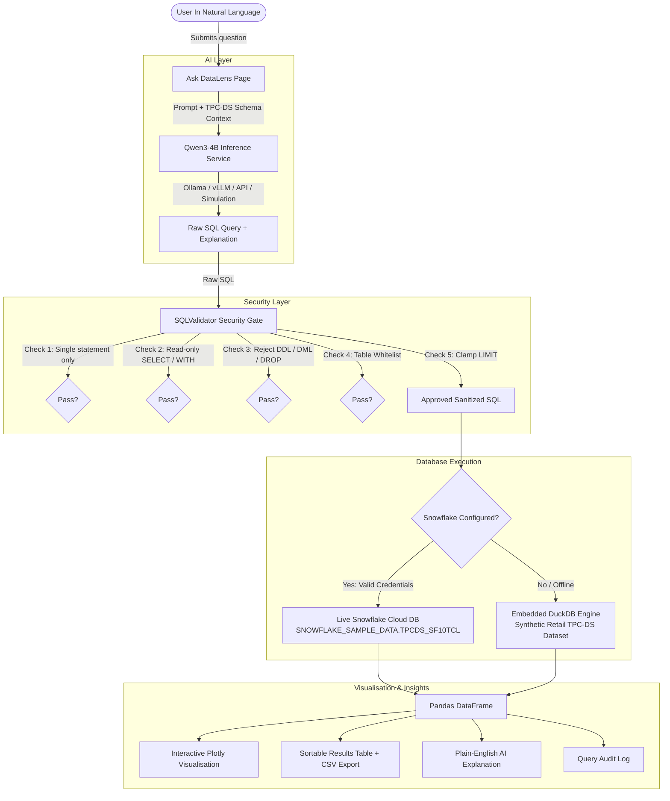

# DataLens — AI-Powered Retail Analytics Platform

[](https://streamlit.io/)
[](https://python.org/)
[](https://www.snowflake.com/)
[](https://plotly.com/)
[](LICENSE)

**DataLens** is an enterprise-grade, functional AI-powered data analytics application built for retail sales intelligence. It translates natural language questions into safe, optimized SQL queries, executes them against Snowflake's standard retail schema (`SNOWFLAKE_SAMPLE_DATA.TPCDS_SF10TCL`), visualises trends with interactive Plotly charts, and explains findings in plain English.

---

## 🎨 Design & Colour Palette

DataLens is built with a custom-engineered UI adhering strictly to a premium light analytics theme:

| Element | Color | Hex Code | Description |
| :--- | :--- | :--- | :--- |
| **Global Background** | Very Light Blue / Lavender | `#EEF2FF` | Soft, modern backdrop |
| **Main Cards** | Crisp White | `#FFFFFF` | Rounded with subtle soft grey shadows |
| **Primary Buttons** | Royal Blue | `#4169E1` | Interactive elements and CTAs |
| **Highlights** | Purple | `#8B5CF6` | Category accents and gradient elements |
| **Secondary Accents**| Light Blue | `#BAE6FD` | Chart fills and badges |
| **Typography** | Dark Navy | `#172554` | High contrast, accessible typography |
| **Borders** | Soft Light Grey | `#E5E7EB` | Clean structural dividing lines |

---

## 📑 Feature Modules

### 1. 🏠 Executive Dashboard (`app.py`)
- **4 Key Performance Indicators (KPIs):** Total Sales, Total Items Sold, Total Sales Records, and Top-Selling Product.
- **Interactive Visualisations:**
  - Sales by product category (horizontal/vertical bar chart).
  - Sales trends over time (multi-year monthly time-series spline).
  - Top 10 products by sales revenue.
  - Store, web, and catalog multi-channel comparison donut chart.
- **Recent Queries Feed:** Quick audit of recently executed inquiries.
- **Quick Navigation:** One-click shortcuts to analytics modules.
- **Mandatory Demo Warning:** Prominently displays `DEMO DATA — NOT LIVE SNOWFLAKE RESULTS` when running offline.

### 2. 💬 Ask DataLens (`pages/1_Ask_DataLens.py`)
- Natural-language query input box with clickable sample prompts:
  - *"Which products generated the highest sales?"*
  - *"What are the top 10 best-selling products?"*
  - *"Which month had the highest sales?"*
  - *"Which product categories perform best?"*
  - *"How do store, web, and catalog sales compare?"*
  - *"What is the average quantity sold per product?"*
- Schema-conditioned prompting to **Qwen3-4B**.
- Dedicated security validation layer (`SQLValidator`).
- Live or demo query execution.
- Dynamic interactive Plotly charts (auto-selected: bar, line, or donut).
- Plain-English narrative explaining how results were calculated.
- SQL inspection tab displaying sanitized, syntax-highlighted SQL.
- One-click CSV export of query results.

### 3. 📊 Sales Analytics (`pages/2_Sales_Analytics.py`)
- Slicers for Product Category and Calendar Year.
- Filtered metrics: Total Filtered Sales, Units Sold, Transactions, Average Order Value (AOV).
- Monthly sales trajectory spline chart.
- Store vs. Web vs. Catalog channel distribution.
- Complete product-level performance matrix with unit price, volume, and revenue.

### 4. 🏷️ Product Analysis (`pages/3_Product_Analysis.py`)
- Side-by-side Top 10 rankings:
  - Top 10 Products by Revenue.
  - Top 10 Products by Volume (Units Sold).
- Keyword search by product title or brand (e.g. OLED, ApexTech, Parka).
- Product category filter.
- Inventory matrix with lifetime gross revenue and current pricing.

### 5. 🔍 Data Explorer (`pages/4_Data_Explorer.py`)
- Live metadata explorer for `SNOWFLAKE_SAMPLE_DATA.TPCDS_SF10TCL`.
- Whitelisted retail tables: `STORE_SALES`, `WEB_SALES`, `CATALOG_SALES`, `ITEM`, `CUSTOMER`, `DATE_DIM`.
- Column data dictionary (columns, data types, descriptions, join relationships).
- Guardrailed table row previews with configurable row limits (10, 25, 50).
- Mermaid Entity-Relationship Diagram (ERD).

### 6. 📜 Query History (`pages/5_Query_History.py`)
- In-memory audit trail of all natural-language requests.
- Metrics on total questions, success rate, blocked attacks, and execution duration.
- Expandable logs with SQL inspection and row counts.
- History reset button.

### 7. ⚙️ Settings & Diagnostics (`pages/6_Settings.py`)
- Snowflake connection test button and connection status badge.
- Qwen3-4B inference endpoint configuration and reachability ping tool.
- Step-by-step setup guide for Snowflake and Ollama.
- Zero-exposure credential masking.

---

## 🛠️ Technology Stack

- **Frontend & App Framework:** [Streamlit](https://streamlit.io/)
- **Programming Language:** Python 3.10+ (tested on Python 3.14)
- **Runtime AI Model:** Qwen3-4B (configurable inference via Ollama / vLLM / OpenAI-compatible / Hugging Face endpoint, with high-fidelity deterministic fallback simulation)
- **Database:** Snowflake (`snowflake-connector-python`) querying `SNOWFLAKE_SAMPLE_DATA.TPCDS_SF10TCL`
- **Development Assistant:** Snowflake CoCo / Cortex Code
- **Local Demo Engine:** DuckDB (in-memory embedded SQL engine)
- **Data Processing:** Pandas
- **Interactive Visualisations:** Plotly Express & Plotly Graph Objects
- **Version Control:** Git & GitHub

---

## 📐 System Architecture & Data Flow



---

## 🚀 Installation & Startup Instructions

### 1. Prerequisites
- Python 3.10 or higher.
- Git.
- (Optional) [Ollama](https://ollama.com/) for local Qwen3-4B inference.

### 2. Clone the Repository
```bash
git clone https://github.com/your-username/datalens.git
cd datalens
```

### 3. Install Dependencies
```bash
pip install -r requirements.txt
```

### 4. (Optional) Generate or Refresh Demo Datasets
A full synthetic dataset with 3,200 retail records and TPC-DS entities is pre-bundled in `data/`. To re-generate:
```bash
python data/generate_demo_data.py
```

### 5. Launch the Application
```bash
streamlit run app.py
```
Open your browser at `http://localhost:8501`.

---

## ❄️ Snowflake Configuration

DataLens queries Snowflake's pre-existing sample dataset:
- **Database:** `SNOWFLAKE_SAMPLE_DATA`
- **Schema:** `TPCDS_SF10TCL`
- **Tables:** `STORE_SALES`, `WEB_SALES`, `CATALOG_SALES`, `ITEM`, `CUSTOMER`, `DATE_DIM`

### Step 1: Create Secrets File
Copy `.streamlit/secrets.toml.example` to `.streamlit/secrets.toml`:

```toml
[snowflake]
account = "xy12345.us-east-1"
user = "your_username"
password = "your_password"
warehouse = "COMPUTE_WH"
database = "SNOWFLAKE_SAMPLE_DATA"
schema = "TPCDS_SF10TCL"
role = "ACCOUNTADMIN"
```

Alternatively, set environment variables:
```bash
export SNOWFLAKE_ACCOUNT="xy12345.us-east-1"
export SNOWFLAKE_USER="your_username"
export SNOWFLAKE_PASSWORD="your_password"
export SNOWFLAKE_WAREHOUSE="COMPUTE_WH"
```

> **Note:** DataLens operates in read-only mode and **never creates, modifies, or deletes shared sample database objects**.

---

## 🤖 Qwen3-4B Configuration

DataLens uses **Qwen3-4B** as its runtime model for natural language to SQL translation.

### Option A: Local Ollama (Recommended)
1. Install [Ollama](https://ollama.com).
2. Download and run Qwen3-4B:
   ```bash
   ollama pull qwen3:4b
   ollama run qwen3:4b
   ```
3. Ollama will run at `http://localhost:11434/api/generate`. DataLens connects to it automatically.

### Option B: Remote / vLLM / OpenAI-Compatible Endpoint
In `.streamlit/secrets.toml` or via **Settings**:
```toml
[qwen]
endpoint_url = "http://your-server:8000/v1/chat/completions"
model_name = "qwen3:4b"
api_key = "optional-bearer-token"
temperature = 0.1
```

### Option C: Offline / Fallback Demo Mode
If the Qwen3-4B endpoint is unreachable or not yet configured:
- DataLens automatically activates its **built-in natural-language semantic generator**.
- Queries are labelled as `Qwen3-4B (Simulated — Offline)`.
- **Never silently substitutes another model.**

---

## 🛡️ SQL Security & Validation Layer

All SQL generated by the AI is treated as untrusted and evaluated by `services/sql_validator.py`:

1. **Read-Only Enforcement:** Strictly requires statements to begin with `SELECT` or `WITH`.
2. **Prohibited Command Blocking:** Instant rejection of `INSERT`, `UPDATE`, `DELETE`, `DROP`, `ALTER`, `CREATE`, `TRUNCATE`, `MERGE`, `EXEC`, `CALL`, `GRANT`, `REVOKE`, etc.
3. **Multi-Statement Defense:** Semicolons within query bodies are rejected to stop chained query injection attacks.
4. **Table Whitelisting:** Referenced tables are verified against the approved retail schema (`STORE_SALES`, `WEB_SALES`, `CATALOG_SALES`, `ITEM`, `CUSTOMER`, `DATE_DIM`).
5. **Compute Safeguard (LIMIT Clamping):** Automatically appends `LIMIT 100` or caps user-requested limits at 100 to prevent runaway warehouse consumption.

---

## 📦 High-Fidelity Demo Mode

When Snowflake credentials are not supplied:
- DataLens runs completely offline using an embedded DuckDB engine.
- A synthetic retail dataset of 3,200 orders across 2024–2025 is queried with zero cloud dependencies.
- Every page and result displays the exact mandatory badge:
  > ⚠️ **DEMO DATA — NOT LIVE SNOWFLAKE RESULTS**

Demo data and live data are never conflated.

---

## ❄️ Snowflake CoCo Usage & Evidence

During DataLens architecture and query formulation, **Snowflake CoCo** (Snowflake Cortex Code / Development Assistant) was utilized as the developer-facing workbench:

### Workflow Distinction
- **Snowflake CoCo:** Used by engineers in development to:
  - Explore the `SNOWFLAKE_SAMPLE_DATA.TPCDS_SF10TCL` table catalog and column types.
  - Verify column semantics: `ss_ext_sales_price` (extended gross revenue) vs `ss_sales_price` (unit transaction price).
  - Draft and benchmark high-performance SQL join paths between `STORE_SALES`, `ITEM`, and `DATE_DIM`.
- **Qwen3-4B:** The runtime inference model executed inside the user application to understand natural language questions from business users.

```
+-----------------------------------------------------------------------+
|  DEVELOPMENT WORKSPACE                                                |
|  Snowflake CoCo / Cortex Code Assistant                               |
|  --> Schema Exploration (TPCDS_SF10TCL)                               |
|  --> SQL Optimization & Semantic Validation                           |
+-----------------------------------------------------------------------+
                                    |
                                    v [Codified into services & schemas]
+-----------------------------------------------------------------------+
|  RUNTIME USER APPLICATION (DataLens)                                  |
|  User Question  -->  Qwen3-4B AI Model  -->  SQLValidator  --> Snowflake |
+-----------------------------------------------------------------------+
```

---

## ⚖️ Current Limitations & Future Improvements

### Current Limitations
- **Read-Only:** System only performs analytical reads; no writeback or data editing is supported.
- **Single Warehouse:** Queries are optimized for Snowflake standard compute warehouses.
- **Session History:** Query history is kept in memory during the active session.

### Future Improvements
- Multi-warehouse auto-scaling routing based on query complexity.
- User authentication and role-based access control (RBAC).
- Scheduled automated email and Slack report digests.
- Vector database semantic caching for repeated natural language queries.

---

## 📄 License
This project is licensed under the MIT License.
